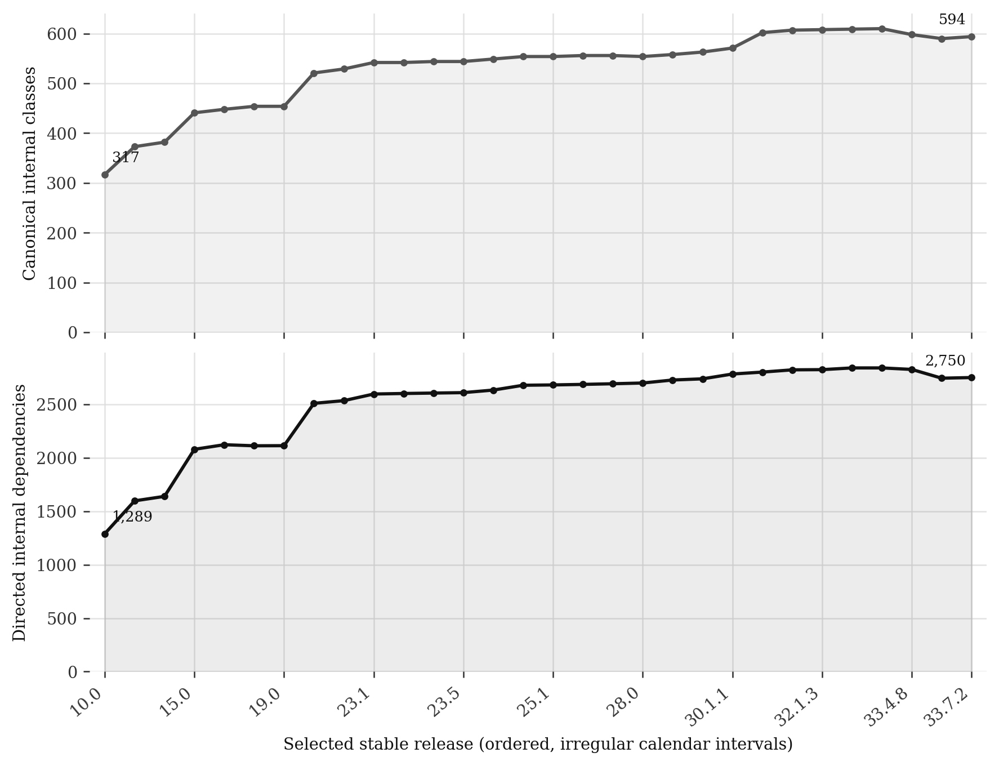

# Guava architecture evolution — EPL484 Project 1

A reproducible study of **30 deliberately spaced stable Guava releases**, from 10.0 (2011-09-28) to 33.7.2 JRE (2026-09-29). Each version has one frozen analysis configuration and the four conditions required by the assignment: A1 ACDC/full, A2 ACDC/without omnipresent classes, A3 k-means/full, A4 k-means/without omnipresent classes. There are **120 finalized partitions**, plus the separate latest-version AI recovery.

**Start with the [PDF report](report/guava_evolution_report.pdf), [results explanation](docs/results_interpretation.md), and [oral-exam guide](docs/oral_exam_guide.md).** The [two-person commit roadmap](docs/commit_roadmap.md) assigns balanced review and development work for 17–23 October. The initial preparation is AI-assisted; the roadmap describes real student work to perform, without invented authors or backdated commits.

## Main findings

| Measurement | Guava 10.0 | Guava 33.7.2 |
|---|---:|---:|
| Canonical outer-class nodes | 317 | 591 |
| Directed internal dependencies | 1,693 | 3,969 |
| Code lines in graph-owned source files | 48,821 | 95,800 |

The endpoint increase is 86.4% in class nodes and 134.4% in dependencies. These are structural measurements, not a direct measure of functionality or architectural quality. Source-backed change-point checks show that annotation changes explain most of the pronounced jumps around 31.1 and 33.4.1. [change_points.json](results/change_points.json) preserves the exact added/removed edges and source lines.



For the latest release, JNode-UE removes 22 of 591 classes. It removes `Preconditions` because use is spread widely across callers; it retains `Iterators` because `Iterables` has a strong specialized dedication to it. The [exact case study](docs/ue_case_study.md) works through both decisions using real member dependencies. UE also removes important API types such as `ImmutableList`; this is a preprocessing classification, not a recommendation to delete those classes from Guava.

| Latest condition | Nodes | Clusters | Cohesion | Coupling | Lecture MQ |
|---|---:|---:|---:|---:|---:|
| A1 — ACDC/full | 591 | 95 | 0.407818 | 0.004596 | 0.403222 |
| A2 — ACDC/filtered | 569 | 98 | 0.391992 | 0.003950 | 0.388041 |
| A3 — k-means/full | 591 | 18 | 0.110793 | 0.010189 | 0.100604 |
| A4 — k-means/filtered | 569 | 18 | 0.127155 | 0.007951 | 0.119204 |

The filtered conditions have a different graph. After projecting the full partition onto **the same retained graph**, filtering improves MQ in 23/30 ACDC cases and 26/30 k-means cases. It does not always help. The latest same-graph change is −0.003196 for ACDC and +0.022611 for k-means. The large difference in cluster granularity also prevents interpreting a higher ACDC MQ as proof that it recovered the intended design.

The blind AI experiment produced one complete **18-module** conceptual architecture. Its full-graph MQ is 0.098655, close to the structural k-means value, with adjusted Rand agreement 0.188980 against A3. Its responsibility names help explain the library, but no intended-architecture ground truth establishes accuracy. The exact [prompt and evidence](results/ai/experiment.json), [response](results/ai/response.md), [assignment](results/ai/assignment.csv), and [comparisons](results/ai/comparisons.csv) are preserved.

All 30 size rows are in [sizes.csv](results/sizes.csv), all 120 required metric rows in [metrics.csv](results/metrics.csv), and the fair scope comparisons in [same_graph_comparisons.csv](results/same_graph_comparisons.csv).

## Reproduce from a fresh clone

The tested environment is Python 3.12 and Java 17. The Python dependency closure is pinned in `requirements.lock.txt`. Use a Java 17+ installation; `EVOLUTION_JAVA` may point to its `java` executable if it is not on PATH. The included, checksum-pinned Eclipse compiler means a separate `javac` installation is not required.

```bash
git clone https://github.com/ckontz01/software-evolution-ex1.git
cd software-evolution-ex1
python -m venv .venv
source .venv/bin/activate
python -m pip install -r requirements.lock.txt
python scripts/unpack_data.py
python scripts/fetch_tools.py
python scripts/run_checks.py
python scripts/fetch_data.py --offline --verify-git
python scripts/validate_results.py
```

`unpack_data.py` restores every raw/derived file and verifies SHA-256 at both archive and member level. It refuses to overwrite a differing local file. The 32 deterministic archives preserve **1,829 files**, including all 90 original Maven artifacts, the two endpoint Git archives, and the complete detailed results. The [archive manifest](archives/manifest.json) enumerates every stored member. Original Git/source comparisons are cached for the first and last releases only; intermediate source artifacts are hash-pinned, without claiming every release was compared file-for-file with Git.

To repeat the computations into a separate output directory:

```bash
python scripts/run_study.py --phase all --graph-root data/recomputed_graphs --output results/rerun/recomputed
```

This recompiles the Java tools, extracts the 30 graphs, builds the shared feature universe, repeats the pilot, and runs A1–A4. Wall times and environment metadata will change; the preserved submission data remains available in the archives. The strict independent validator audits the canonical restored study. To replace canonical results intentionally, use the default paths and regenerate dependent figures/report afterward.

Rebuild the supplementary evidence and report after restoring canonical data:

```bash
python scripts/benchmark_ue.py
python scripts/audit_ue_cases.py
python scripts/audit_change_points.py
python scripts/evaluate_ai.py
python scripts/build_report.py
```

The AI prompt/response is a recorded experiment, not an API call silently repeated by these commands. `evaluate_ai.py` verifies frozen input hashes and scores the saved partition. A new AI session can produce a different proposal; preserve a separate record for that experiment. Fixed seeds and pinned numerical packages improve repeatability; cross-platform floating-point bit identity is not promised.

## Choose k directly or inspect one version

The finalized study does not search for the best k. It uses the predeclared rule:

$$
k=\left\lceil\sqrt{n_{full}/2}\right\rceil.
$$

The same k is used before/after removal, with a clamp only if fewer nodes remain. This is an engineering granularity heuristic, not a lecture theorem or proof of optimality. It produces k = 13–18 across the sample. The seed is 484, with 10 initializations and a 300-iteration limit. The pilot changes ACDC's size parameter on one middle release; it does not sweep k.

For an explicit reviewer-selected k or threshold change, use a new exploration directory:

```bash
python scripts/explore_release.py --version 33.7.2 --k 12 --acdc-size 20 --usage-threshold 0.85 --cardinality-threshold 0.90 --output results/rerun/my_k12
```

This uses the same extracted evidence and feature schema but does not change `config/analysis.json` or the 120 finalized results. A successful manual-k-12 smoke run was performed separately during tool verification.

## Standalone JNode-UE replacement

The supplied JNode was not used. The new implementation follows **Yano and Matsuo, “Moderate Detection and Removal of Omnipresent Modules in Software Clustering” (2020)**, equations 1–3, PDF p. 2 / printed p. 663. It implements the paper's **UE** method. Historical JNode/Noise uses different ComponentRank/shortest-path logic; this repository does not mislabel UE as a faithful reimplementation of that earlier algorithm.

```bash
python scripts/jnode_ue.py --classes data/graphs/33.7.2/classes.csv --members data/graphs/33.7.2/member_dependencies.csv --output results/rerun/ue_demo
```

The output includes every class's dedication, usage equality, cardinality, strongest caller and decision reason. Only distinct, resolved internal method/field uses enter the paper's member-based counts. Inner/anonymous ownership is merged while original member identities remain distinct. Both thresholds must hold: usage equality ≥ 0.85 and cardinality ≥ 0.90. Removal is simultaneous in one pass; zero incoming evidence does not cause removal.

The detector uses set aggregation and indexed lookups. In the saved synthetic benchmark, 10,000 classes and 200,000 distinct member references take a median **1.236 s** over three detector-only runs. [Benchmark data](results/performance/ue_benchmark.json) records all measurements, input construction, environment and memory qualifications. This is not a measured speedup against the supplied JNode.

## Scope, relations and features

Only source-owned `com.google.common` production classes in the selected main/JRE artifact become nodes. External JDK classes, Guava dependencies, annotations supplied by other libraries, bundled `com.google.thirdparty.publicsuffix`, Android variants, GWT artifacts, tests and benchmarks are excluded. Stable releases containing `@Beta` API annotations remain included; beta/RC/snapshot **releases** are excluded.

The extractor recognizes the seven tutorial relations: inheritance, interface implementation, method calls, method parameter types, field references, type usage and declared thrown exceptions. Every type is retained in the audit CSV; the metric graph is the binary directed union, with one edge per ordered class pair and no self-loops. Repeated calls and multiple relation types do not multiply a pair's weight. A pair legitimately has no edge when no included relation exists.

Inner, nested, local and anonymous classes are merged through class-file enclosing metadata, not by blindly cutting names at `$`. Legitimate top-level dollar names remain distinct. The extractor uses base entries for multi-release JARs. It never runs Guava application classes and does not claim complete runtime dispatch/reflection recovery.

All releases use the same **712-class union coordinate system**. K-means receives 1,424 sparse outgoing/incoming feature columns, constructed as `[A+I,(A+I)^T]` and row-L2 normalized. Removed/absent class coordinates remain present as zero evidence. Identity entries distinguish isolated rows and never enter the dependency graph used for metrics. Package names are identifiers, not k-means features.

The original York **ACDC** source is preserved unmodified. A reversible `CLASS.java` adapter prevents the original filename-based container naming from collapsing same-package classes. True isolates are restored as singleton groups. The [28.2 pilot](docs/pilot_decision.md) produced identical valid partitions at sizes 10/20/40, so size 20 was retained globally. The limit applies to the SubGraph phase; later adoption can create larger final clusters.

## Lecture metrics and interpretation

The implementation uses the reconstruction lecture's loop-free density formulation (PDF pp. 15–17), including all unordered cluster pairs when averaging coupling:

$$
A_i=\frac{\mu_i}{n_i(n_i-1)},\qquad
E_{ij}=\frac{\epsilon_{ij}}{2n_in_j},\qquad
MQ=\frac1k\sum_iA_i-\frac{2}{k(k-1)}\sum_{i<j}E_{ij}.
$$

`epsilon` counts both dependency directions. Singleton cohesion and the single-cluster coupling term are zero; empty graphs also return zero by documented convention. Per-cluster and per-pair CSVs preserve each term. Supplementary weighted cohesion and inter-edge fraction help explain granularity effects but do not replace the required lecture metrics.

Static partitions describe the analyzed implementation. They do not establish the intended architecture, functional completeness, requirements satisfaction or architectural erosion. The course's Lehman discussion is used with that empirical limitation. Adjusted Rand values measure agreement/stability, not accuracy without validated ground truth. The AI comparison additionally receives class names and documentation, so it uses an explicitly different information setting.

## Selected releases

```text
10.0, 11.0, 12.0, 13.0.1, 15.0, 16.0.1, 18.0, 21.0,
23.0, 23.2, 23.5, 24.0, 25.1, 27.0, 27.1, 28.2, 30.0,
30.1.1, 31.1, 32.0.1, 32.1.2, 33.0.0, 33.2.0, 33.3.1,
33.4.1, 33.4.3, 33.4.6, 33.4.8, 33.7.0, 33.7.2
```

The sample covers 26 major/minor families and skips at least one eligible stable point between adjacent selections. The choice is rank-spaced over a documented 70-point eligible catalog, independent of clustering results. [Project selection](docs/project_selection.md), [data acquisition](docs/data_acquisition.md), and `config/versions.json` record exclusions, release dates, tags, commit identities, URLs and checksums.

## Evidence and navigation

| Path | Contents |
|---|---|
| `java/DependencyExtractor.java` | Source/member-aware static extraction |
| `src/evolution/` | Graph model, UE, clustering, lecture metrics and runner |
| `tests/` | 42 focused tests including real compiled Java fixtures |
| `archives/` | Complete raw artifacts and detailed per-release results |
| `data/provenance/` | Acquisition receipts, inventories, Git/source checks and eligibility |
| `results/*.csv` | All release sizes, 120 metrics, runtime and comparison tables |
| `results/validation.json` | Independent audit: 3,362,762 evidence checks, zero failures |
| `results/ai/` | Exact prompt, five hashed inputs, initial hypothesis, final assignment and evaluation |
| `results/figures/` | Shareable PNG and SVG charts |
| `docs/` | Methods, course traceability, worked cases, oral-exam and contribution guides |
| `report/` | PDF, generation manifest and rendering checks |

The temporary repository is the requested preparation destination. The teacher-owned repository URL and teammate identity were not supplied; no teacher-repository import, Blackboard upload, student authorship or future commit is represented as already completed. The [roadmap](docs/commit_roadmap.md) gives both students concrete, balanced work to review and commit through their own accounts.
